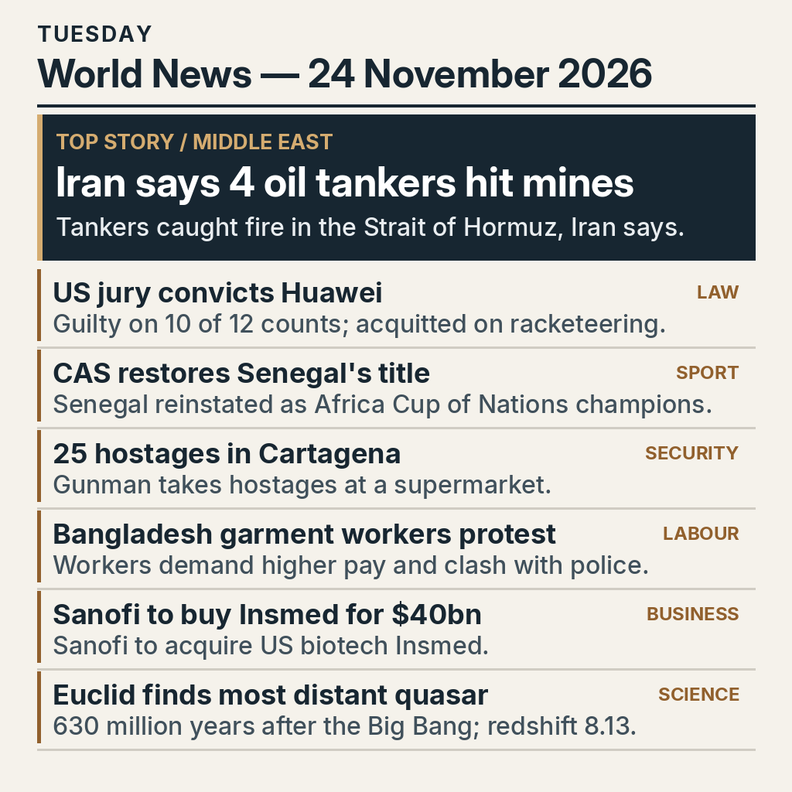

# The World in One Day — 24 November 2026

A one-image summary of the world's news of **Tuesday, 24 November 2026**,
built for the make.fun `news-image-20261124` competition.



## The seven stories

All seven happened, or were first reported, on 24 November 2026. Each was
verified against at least one news source dated that day; the selection was
reconciled across three independent researches (my own, Grok's, and
ChatGPT/GPT-6.2's) and only events all checks agreed on the date for were
kept.

| # | Story | Sources |
|---|-------|---------|
| 1 | **Four tankers hit mines in the Strait of Hormuz, Iran says** — Iran reports four oil tankers caught fire after striking naval mines in the world's busiest oil waterway. | IRNA (05:34Z and 13:32Z, 24 Nov), Al Jazeera liveblog 24 Nov, Mehr News |
| 2 | **US jury convicts Huawei on 10 of 12 counts** — guilty of bank fraud, sanctions violations and stealing trade secrets; acquitted of racketeering conspiracy. | Reuters, US Dept. of Justice, AP, CNN (24 Nov) |
| 3 | **CAS restores Senegal's title** — Senegal reinstated as Africa Cup of Nations champions. | Reuters, AP, Guardian (24 Nov) |
| 4 | **Gunmen hold 25 hostage in Cartagena supermarket** — armed men seize a supermarket in the Colombian city after a failed armoured-vehicle robbery; five elderly women are freed. | Reuters, AP, Al Jazeera (24 Nov) |
| 5 | **Garment workers clash with police in pay protests, Bangladesh** — workers demanding higher pay block highways in Gazipur; police fire tear gas as factories halt. | Reuters, TBS News (24 Nov) |
| 6 | **Sanofi to buy Insmed for $40bn** — Sanofi to acquire US biotech Insmed. | Sanofi press release (Paris, 24 Nov 2026), WSJ |
| 7 | **Euclid finds the most distant quasar ever seen** — announced 24 Nov: a quasar 630 million years after the Big Bang, the first beyond redshift 8. | ESA, AP, Reuters (24 Nov) |

## What was left out, and why

- **Nvidia / Jensen Huang reinstated as CEO** — the board action was on Monday 23 Nov; only the announcement and market reaction fell on the 24th. Not presented as a 24 Nov event.
- **Gaza (Hamas security chief killed) and Zaporizhzhia (Russian strike kills 2, wounds 40+)** — both verified as 24 Nov events, but dropped for breadth: the Hormuz story already carries the day's war news, and the image should span regions and fields, not stack panels on the same conflict.
- **Riyadh PIF Tower attack, Venezuela's $237.5bn debt, UK heat deaths, Guru Nanak's 557th anniversary, Australia's online-safety deal** — all verified 24 Nov events, dropped for breadth in favour of the seven above.
- **NATO nuclear-satellite response, FIFA hosts, ICJ Myanmar ruling, US measles status, Grok lawsuits** — date-checked and excluded (23 Nov or earlier).

## How the image was made

`draw_gpt.py` draws the poster programmatically with Pillow (Python 3, real Inter TTFs) following the GPT-6.2 layout specification (`gpt-layout-spec.md`): ivory newspaper page, navy lead-story block with the date in the masthead, and six secondary stories with field tags. Programmatic drawing keeps every letter crisp — no AI-generated text. The image is 1024×1024 PNG, 138,801 bytes (limit: 1 MiB), and byte-identical across repeated runs of `draw_gpt.py` and of `main.ts` (verified: same SHA-256).

`main.ts` is the competition entrypoint (Node 22, standard library only): the
grader runs with no network, so it copies the finished `entry.png` beside it
into `/output/entry.png`.

## Verify locally

```sh
python3 draw_gpt.py        # regenerates entry.png (deterministic)
mkdir -p out && MAKEFUN_OUTPUT_DIR=out node main.ts   # writes out/entry.png
sha256sum entry.png out/entry.png                      # the two must match
```

## Licence

MIT — see `LICENSE`.
